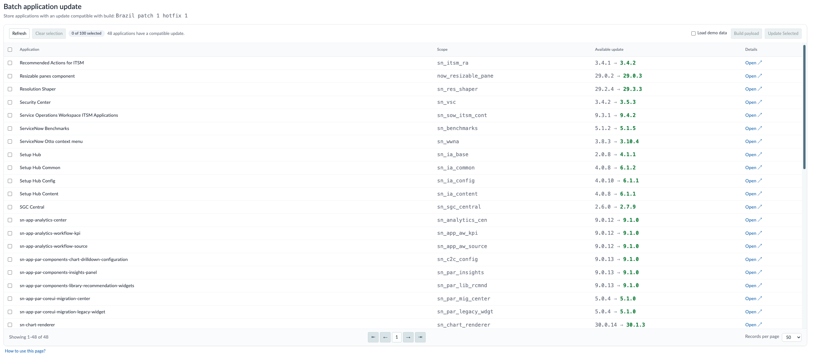
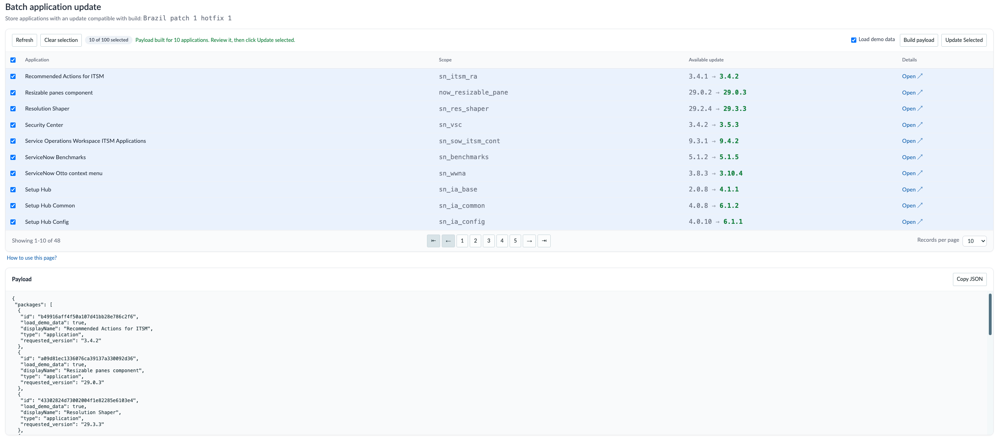
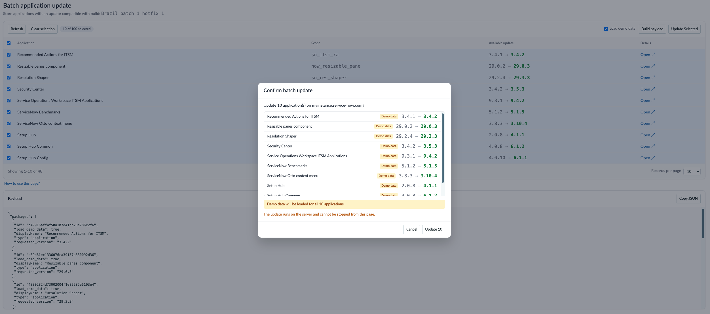
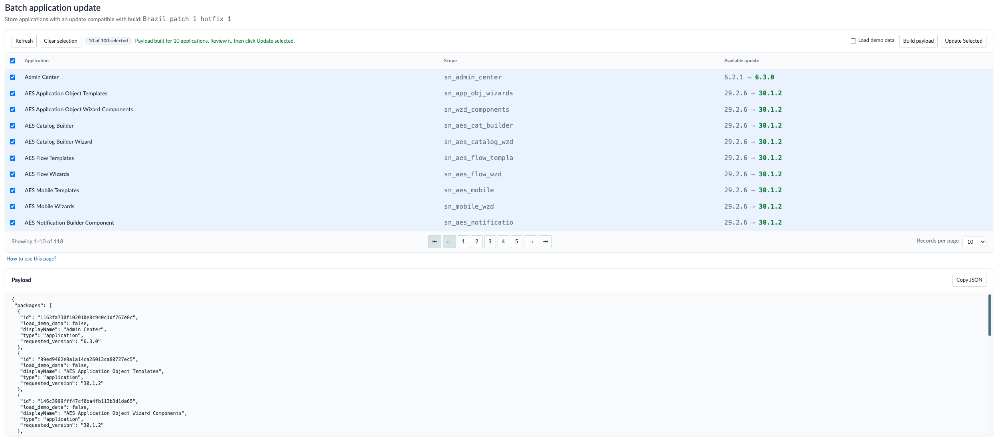
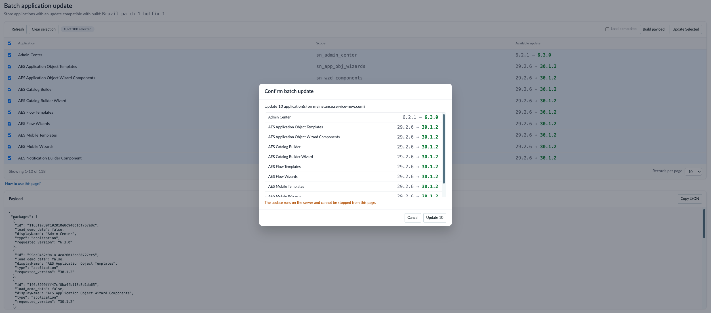
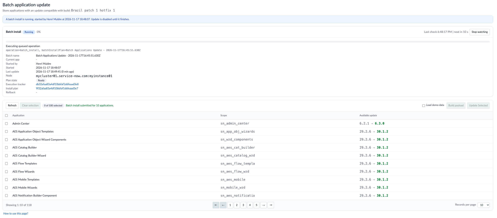
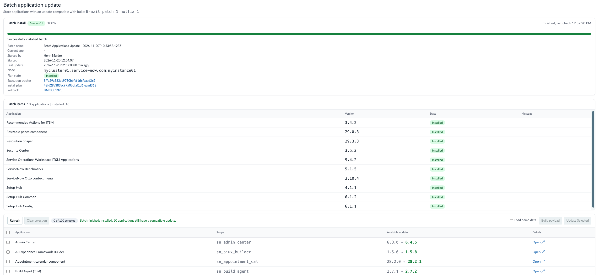

# Batch Application Update for ServiceNow
 
A UI page for ServiceNow admins that lists installed store applications with an available update, lets you select up to 100 of them and updates them in one batch through the CI/CD API. Application Manager updates applications one at a time. This page sends them as a single batch install and tracks its progress.
 

 
The request runs as the logged-in user, the same way REST API Explorer does. No integration user, credentials or OAuth setup is needed.
 
## Features
 
- Lists installed store applications that have an update compatible with the instance's family release, with installed and target version
- Picks the highest compatible version per application (numeric version comparison)
- Details link per application that opens its target version in Application Manager in a new tab
- Demo data badge next to applications that already have demo data loaded
- Pagination (10, 50 or 100 per page) and selection of up to 100 applications per batch
- Payload preview with copy to clipboard, so you can review the JSON before anything is sent
- Confirmation dialog that shows the target instance and the list of applications
- Optional "Load demo data" checkbox (unchecked by default)
- Live progress from the execution tracker, plan state and per-application results, with a link to the rollback context
- Resumes tracking after a page reload and blocks a second batch while one is running, including batches started by other admins from this page
- Marks a batch as stalled after 60 minutes without progress
- Shows the installed patch level and warns when an upgrade is assigned but not finished
- Module under **System Definition**
- Required role set in one place (`REQUIRE_ROLE`, default `admin`)
- Built-in help dialog
- All texts are translatable through the Messages table (`sys_ui_message`). English is built in.
## Requirements
 
- The admin role by default. The ACLs, the module and the Script Include check for it. To use another role, see [Using another role](#using-another-role).
- Access to the CI/CD API (`/api/sn_cicd/app/batch/install`) for the user running the page.
- Tested on the Australia and Brazil family releases, in Core UI and inside Next Experience.
## Installation
 
1. Download `update-set/Batch_Application_Update_v1.2.xml`.
2. In your instance, go to **System Update Sets > Retrieved Update Sets** and use **Import Update Set from XML**.
3. Open the imported update set, click **Preview Update Set** and check that there are no problems.
4. Click **Commit Update Set**.
5. Open **System Definition > Batch Application Update** (or direct URL `/batch_app_update.do` or using Next Experience UI `/now/nav/ui/classic/params/target/batch_app_update.do`, if you prefer).
The v1.2 update set is complete and does not require an earlier version. If v1.0 or v1.1 is installed, commit v1.2 over it.
 
Test it on a sub-production instance first.
 
### What the update set contains
 
| Type | Name |
|---|---|
| UI Page | `batch_app_update` |
| Script Include | `BatchAppUpdateAjax` (client callable) |
| Access Control | `batch_app_update` (type `ui_page`, role admin) |
| Access Control | `BatchAppUpdateAjax` (type `client_callable_script_include`, role admin) |
| Access Roles | The two ACL-to-role links for the existing `admin` role |
| Module | `Batch Application Update` in the System Definition menu (role admin) |
 
All records are in the Global scope. The update set contains no translations and changes no existing platform records. The module is added to the existing System Definition menu without changing the menu record.
 
## Usage

1. Open **System Definition > Batch Application Update**. You can also open `/batch_app_update.do` directly or using Next Experience UI `/now/nav/ui/classic/params/target/batch_app_update.do`. The list shows every installed store application with a compatible update.
2. To check what an update contains, click **Open ↗** in the Details column. Application Manager opens the target version in a new tab.
3. Select the applications to update. The header checkbox selects or clears the current page.
4. (optional) Check **Load demo data** only if you want demo data loaded for all applications in the batch, for example on a test, demo or PDI instance.

   <details>
   <summary>Screenshots: payload and confirmation with Load demo data</summary>

   

   

   </details>

5. Click **Build payload** and review the JSON.

   <details>
   <summary>Screenshot: payload preview</summary>

   

   </details>

6. Click **Update selected**, check the instance name and the list in the confirmation dialog, then confirm.

   <details>
   <summary>Screenshot: confirmation dialog</summary>

   

   </details>

7. Follow the progress in the Batch install card. When the batch finishes, the list refreshes.

   <details>
   <summary>Screenshots: batch in progress and finished</summary>

   

   

   </details>

You can reload or close the page while a batch runs. The install continues on the server and the page picks up the running batch when you open it again.
 
## Translations
 
The update set ships only with English. The English texts are also the message keys, so the page works without any translation records.
 
Optional translation scripts are in `translations/`:
 
| Script | Language |
|---|---|
| `install_fi.js` | Finnish (`fi`) |
| `install_sv.js` | Swedish (`sv`) |
| `install_template.js` | Empty template for other languages |
 
Each script is a background script that:
 
- stops if the language is not installed and active on the instance
- creates only the messages that are missing
- never overwrites an existing message and reports keys that already exist with a different text
- runs read-only until you set `READ_ONLY = false`
To apply one, open **System Definition > Scripts - Background**, paste the script and run it. Review the output, then set `READ_ONLY = false` and run it again.
 
Each script covers the page texts and the error messages of the Script Include.
 
If you ran a translation script for an earlier version, run the current version as well. It creates only the messages that are missing.
 
### Adding a language
 
1. Copy `translations/install_template.js` and name it after the language, for example `install_de.js`.
2. Set `LANGUAGE` to the language code from `sys_language`, for example `'de'`.
3. Each line in `MESSAGES` holds the English key and its translation. Write the translation in the empty second string:
```javascript
['Refresh', ''],                              // before
['Refresh', 'Aktualisieren'],                 // after
['Showing {0}-{1} of {2}', 'Zeige {0}-{1} von {2}'],
```
 
4. Keep every placeholder such as `{0}` and `{1}` from the key. Entries with different placeholders are skipped.
5. Entries you leave empty are skipped and stay in English, so a partial translation works.
## Configuration
 
These values are set in code:
 
| Setting | Where | Default | Meaning |
|---|---|---|---|
| `REQUIRE_ROLE` | Script Include | `admin` | Role required for the page data and the batch actions. Shown in the access error and the help dialog. See [Using another role](#using-another-role). |
| `BATCH_PREFIX` | Script Include | `Batch Applications Update` | Start of every batch name. The page finds running batches by this prefix. Do not change it while a batch is running. |
| `STALE_MINUTES` | Script Include | `60` | Minutes without tracker progress before a running batch is shown as stalled and no longer blocks Update |
| `maxBatch` | Client script (`BAU`) | `100` | Maximum number of applications per batch |
| `pageSize` | Client script (`BAU`) | `50` | Default records per page |
 
### Using another role
 
1. Set `REQUIRE_ROLE` in the Script Include `BatchAppUpdateAjax`, for example `'security_admin'`.
2. Change the role on the two ACLs `batch_app_update` and `BatchAppUpdateAjax` (their ACL role links). Editing ACLs usually requires an elevated `security_admin` session.
3. Change **Roles** on the module **System Definition > Batch Application Update**.
4. Both ACLs have **Admin overrides** unchecked, so only users with the role on the ACL pass them. Check it on both ACLs if users with the admin role should also keep access.
5. Test with a user who has only the new role. The batch install still calls the CI/CD API as that user, so the user also needs access to the CI/CD API.
If "Add to Update Set" adds the role record (`sys_user_role`) to your update set, remove that entry.
 
## How it works
 
- **Access:** every client-callable method except `getMessages` checks `gs.hasRole(REQUIRE_ROLE)`. `getMessages` returns only the translated page texts.
- **Candidates:** `sys_store_app` records that are installed, visible and have `update_available=true`. For each one, the highest version in `sys_app_version` whose `compatibilities` contains the instance's `glide.buildname` is used as the target.
- **Details link:** `/now/app-manager/home/app/id/<sys_store_app sys_id>/v/<target version>`.
- **Install:** the browser posts the payload to `POST /api/sn_cicd/app/batch/install` with the session token (`X-UserToken: g_ck`), so the call runs as the logged-in user.
- **Tracking:** the page polls `sys_execution_tracker`, `sys_batch_install_plan` and `sys_batch_install_item` through GlideAjax. Polling backs off when nothing changes and pauses while the browser tab is in the background.
- **Translations:** the page sends its list of message keys to the Script Include, which returns `gs.getMessage()` for each key in the user's session language.
More information about the CI/CD API: [ServiceNow Docs](https://www.servicenow.com/docs/r/api-reference/rest-apis/cicd-api.html)
 
## Notes and limitations
 
- Only store applications are listed. Application customizations are not.
- Compatibility is matched on the family release (`glide.buildname`). The patch level is shown for information only.
- With **Load demo data** unchecked, the batch sends `load_demo_data: false` for every application. Test on a sub-production instance how this behaves for applications that already have demo data.
- The Details link opens Application Manager (`/now/app-manager/...`). Legacy Application Manager is deprecated as of Zurich patch 8 and Australia patch 1, so Application Manager opens in the Next Experience shell even when Next Experience is turned off.
- A batch cannot be stopped from this page. Use the rollback context in the Batch install card if you need to roll back.
- The UI page must have **Direct** unchecked. The page relies on `g_ck`, `GlideAjax` and `addLoadEvent` from the standard page template.
## Uninstall
 
Delete the UI page `batch_app_update`, the Script Include `BatchAppUpdateAjax`, the two ACLs and the module **System Definition > Batch Application Update**. If you ran a translation script, delete its `sys_ui_message` records as well.
 
## Disclaimer
 
This is a community tool and is not affiliated with or supported by ServiceNow. Use it at your own risk and test it on a sub-production instance first.
 
## License
 
Licensed under the MIT License. See [LICENSE](LICENSE).